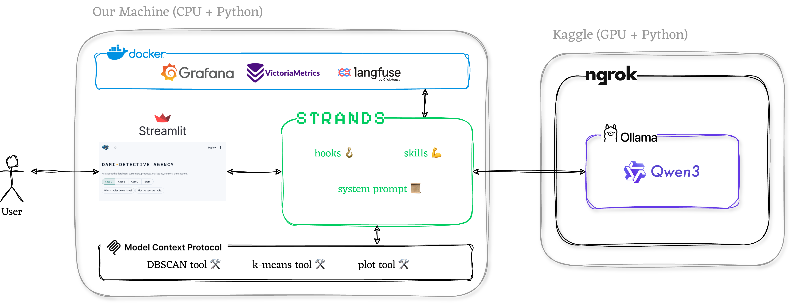

# 🤗 DaMi: Demystifying a dAta mIning AI Agent

👋 Hi and welcome to the 2026-2027 assignment of the _Data Science Principles_ Course at the [School of Informatics, AUTh](https://csd.auth.gr/en/home/)! 

This is the official GitHub repository that contains all the source code, documentation, and instructions you will need to complete the assignment. Let's dive in!

## Goal

The goal of this assignment is to equip you with hands-on knowledge and skills about **Agentic AI**, one of the hottest topics in the tech industry right now. Upon successful completion of the assignment, you will be able to do the following:
1. Name the differences between an LLM 🧠, an AI agent 🤖, and a multi-agent AI system 👾
2. Use human expertise to expand the capabilities of an existing AI agent 🔨
3. Use the right tools to gain control 🛡️ and observability 🔭 over an AI system
4. Set up a fully autonomous, multi-agent AI system to solve a complex task on your behalf 👤 🤝 👾

Exciting, isn't it?

## Introduction

Having recently graduated from the School of Informatics, your team leverages its data mining expertise to run a small startup. The startup specializes in transforming data into insights. Keeping up with the latest trends in the tech industry, your team hires ***DaMi*** (*DAta MIning*), an AI agent that can automate data mining tasks such as clustering and outlier detection. 

**The Problem**: DaMi is keen, but at the same time new on the job: it sometimes picks the wrong algorithm, forgets what you said, and/or says it did things that it actually never did.

**Your Job**: Improve DaMi, one step at a time: First understand how it operates and then open the black box to break, add, and finally improve how DaMi works, leveraging your human data mining knowledge!

**The Structure**: The assignment is organized in small steps, each one of which builds on top of the previous ones, focusing on specific new skills and knowledge. The tasks start easy and get more ... interesting as you move on. But, don't worry! This guide has everything to help you learn through hands-on building! Are you ready?

**The Tech Stack**: We will use [Ollama](https://ollama.com/) to run LLMs of the [Qwen](https://huggingface.co/Qwen) family, leveraging GPU computing power from [Kaggle](https://www.kaggle.com/) located somewhere in the cloud. We will then use [ngrok](https://ngrok.com/) to make the LLM accessible from our local machines. On our machines, we will run a [Strands](https://strandsagents.com/) agent connected to a local [MCP Server](https://modelcontextprotocol.io/). We will communicate with the agent through a [Streamlit](https://streamlit.io/) UI. Optionally, we will keep a close eye on our agent's logs and internals through [langfuse](https://langfuse.com/), [VictoriaMetrics](https://victoriametrics.com/), and [Grafana](https://grafana.com/); all running via [Docker](https://www.docker.com/).



## Step 0: Pre-requisites

This section describes how to install the needed tooling to run DaMi for the first time. **Both persons** in the team need to complete these steps **only once**. We distinguish between required and nice-to-have setups below. 

### 0.1. Required Installations

Please make sure that you set up all the tools specified in the following table following the instructions in the "How" column:

| Tool | Why | How |
|---|---|---|
| uv| Manage Python and packages | Follow the [uv installation guide](https://docs.astral.sh/uv/getting-started/installation/) depending on your OS. Check with `uv --version`.|
| [Node.js](https://nodejs.org) (LTS, **22.19 or newer**) | Test tools without the LLM | Download the latest LTS version from the official [Node.js installation guide](https://nodejs.org/en/download). Check with `node --version`. |
| Kaggle account | Run LLM inference that powers DaMi | Register at [kaggle.com](https://www.kaggle.com/account/login?phase=startRegisterTab) and **verify your phone number** (*Settings → Phone verification*). Phone verification is required to run notebooks on GPU, which will be needed for this assignment.|
| ngrok account | Make the LLM running on Kaggle accessible from your local machine | Register at [ngrok.com](https://dashboard.ngrok.com/signup). Then note your **authtoken** from [Your Authtoken](https://dashboard.ngrok.com/get-started/your-authtoken). This authtoken will be needed below.|


### 0.2. Nice-to-have Installations

Optionally set up docker following the instructions in the "How" column of the following table:

| Tool | Why | How |
|---|---|---|
| docker | Run the observability stack | Follow the [Docker Engine Installation Guide](https://docs.docker.com/engine/install/) based on your OS. Check with `docker compose version`|

> Note: Docker can be installed on MacOS and Linux, but Windows machines are not supported. If you are a Windows user, we highly recommend setting up [Windows Subsystem for Linux (WSL)](https://learn.microsoft.com/en-us/windows/wsl/install) and running docker from there.

#### What happens if I do not setup docker?
Although there is a clear path for Windows users to setup Docker inside WSL, we have decided to make this an **optional**, yet **highly-recommended** setup. In this assignment, we will use Docker to run AI observability tools, such as [langfuse](https://langfuse.com/), which are widely used in the tech industry as AI agents are becoming ubiquitous. Students that decide to not setup docker will simply skip this part of the assignment.

### 0.3. Finishing Touches

Good news: No more installations! Time for a last batch of one-off setup commands and then we are ready for action!

#### 0.3.1. Get the code of this repository on your machine
On your machine, run the following commands in a terminal:
```bash
git clone https://github.com/Bilpapster/DaMi.git dami && cd dami
uv sync
source .venv/bin/activate    # Windows: .venv\Scripts\activate
cp .env.example .env
dami --help                  # you should see the list of commands
```

> _Note_: These commands need to run **only the first time**. For every next time, only run `source .venv/bin/activate` (Linux/MacOS) or  `.venv\Scripts\activate` (Windows) and the `dami` command suite will be readily available.

#### 0.3.2. Login to Kaggle from your terminal

On your machine, run the following command in a terminal and follow the instructions:
```bash
kaggle auth login
```

> _Note_: This authentication needs to run **only the first time**.

#### 0.3.3. Setting up the `.env` file

Update the following lines in your `.env` file:
```env
KAGGLE_NOTEBOOK=<your-username>/llm-dami
NGROK_AUTHTOKEN=<your ngrok authtoken>
```

> _Note 1_: Make sure to update `<your-username>` with your actual Kaggle username. If you are not sure what is your username, go to [kaggle.com](https://www.kaggle.com) -> (top right corner icon) -> "Your Profile". Your username is in the URL, e.g., for `https://www.kaggle.com/johndoe`, the username is `johndoe`.

> _Note 2_: Make sure to update `<your ngrok authtoken>` with your actual ngrok authtoken obtained during step 0.1. You can always find it at [ngrok's "Your Authtoken" page](https://dashboard.ngrok.com/get-started/your-authtoken).

> _Note 3_: This setup needs to happen **only the first time**.

🎉🎉🎉 Congratulations! You have completed all pre-flight steps. You are now ready to start with the assignment steps! They are all under `assignment_steps/` in this repository. See you there 👋 !